# VaultBox – Secure Cloud File Vault

A zero-knowledge, end-to-end encrypted cloud file vault. Files are encrypted in the browser with the Web Crypto API **before** upload, so the server only ever stores ciphertext and wrapped keys, never plaintext or raw encryption keys.

Built as the mini project for **EC4307 – Web Application Development**.


---

## Table of Contents

1. [Features](#features)
2. [Screenshots](#screenshots)
3. [Tech Stack](#tech-stack)
4. [Architecture and Security Model](#architecture-and-security-model)
5. [CRUD Coverage](#crud-coverage)
6. [Database Design (ERD)](#database-design-erd)
7. [Project Structure](#project-structure)
8. [Getting Started](#getting-started)
9. [Environment Variables](#environment-variables)
10. [Docker Deployment](#docker-deployment)
11. [REST API Reference](#rest-api-reference)
12. [Validation and Error Handling](#validation-and-error-handling)
13. [Security Notes and Limitations](#security-notes-and-limitations)
14. [Author](#author)

---

## Features

- **Client-side encryption** – AES-256-GCM file encryption with a unique key and 12-byte IV per file.
- **Password-derived master key** – PBKDF2 (SHA-256, 310,000 iterations) with a per-user 16-byte salt.
- **Secure sharing** – file keys are re-wrapped with the recipient's RSA-OAEP (2048-bit) public key; the server never sees a raw key.
- **Folders** – nested folders with colour tags, rename, and delete (contents are preserved in the parent).
- **File versioning** – uploading a file with the same name in the same folder creates a new version; any version can be restored or downloaded.
- **Preview in memory** – decrypt and preview images, PDFs, and text files without writing plaintext to disk.
- **Search, filter and sort** – by name, file type, date, and size; grid and list views.
- **Audit logging** – activity trail with action and date filters, CSV export, and per-file download history.
- **Dashboard** – storage quota, file and folder counts, shared-file count, and recent activity.
- **Authentication** – bcrypt password hashing, JWT sessions, and rate-limited auth endpoints.
- **Responsive UI** – light and dark themes, toast notifications, and confirmation dialogs for destructive actions.

---

## Screenshots


| Login | Register |
| :---: | :---: |
| 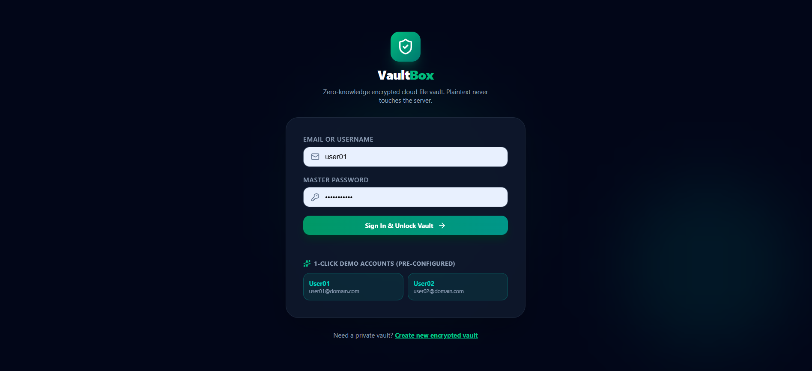 | 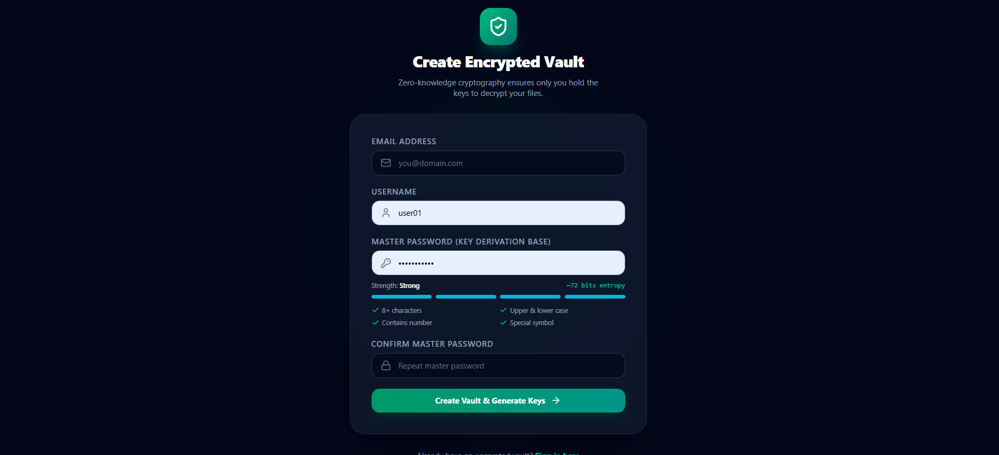 |

| Vault (Grid View) | Vault (List View) |
| :---: | :---: |
| 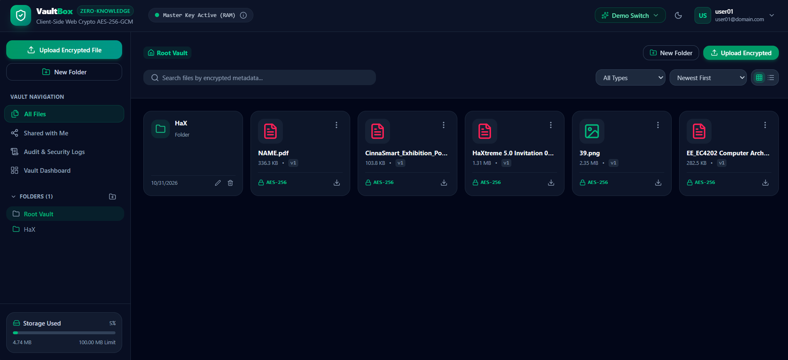 | 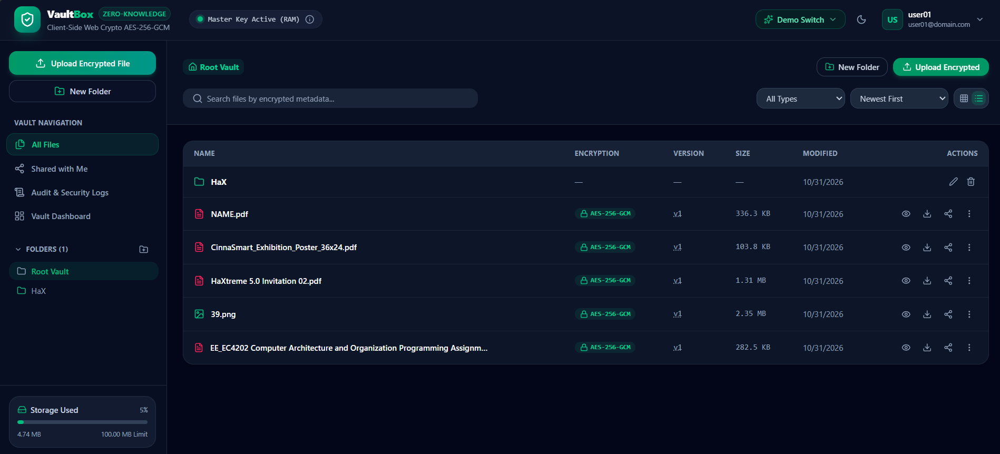 |

| Upload and Encrypt | Share Modal |
| :---: | :---: |
| 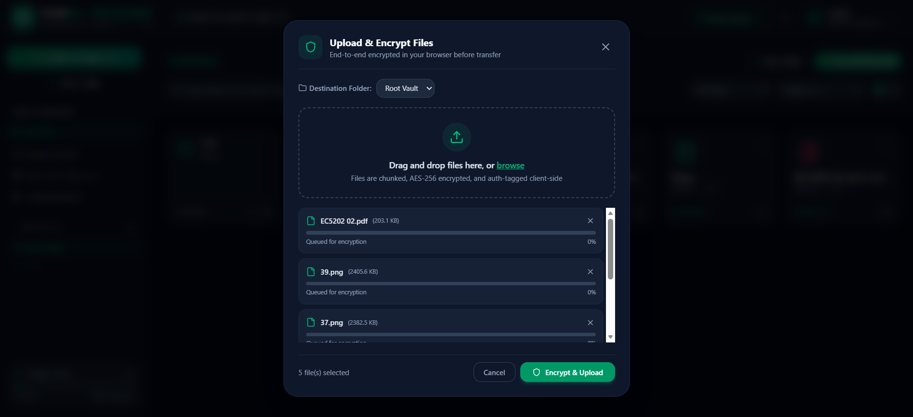 | 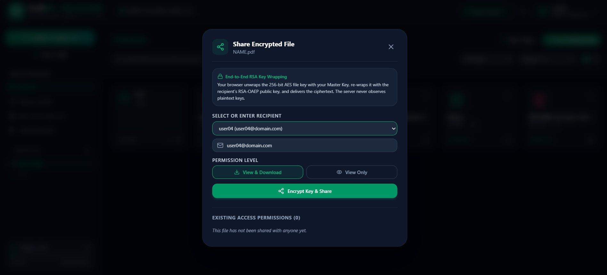 |

| Version History | Audit Logs |
| :---: | :---: |
| 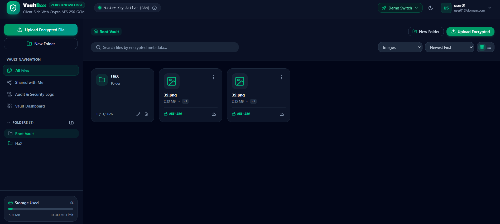 | 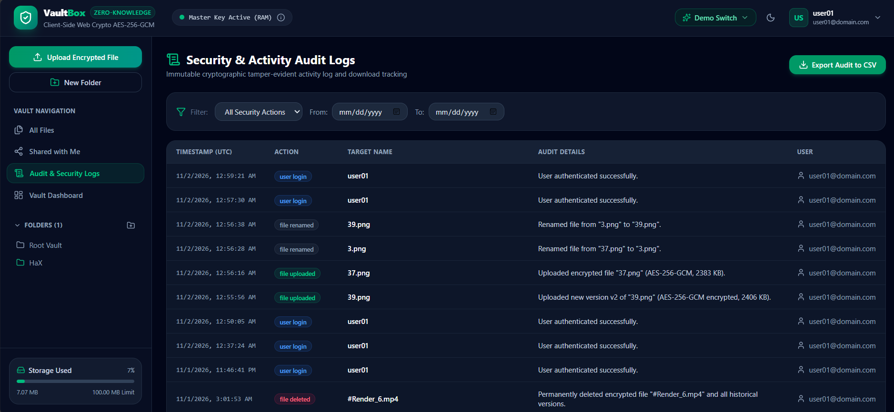 |

| Dashboard | Crypto Inspector |
| :---: | :---: |
| 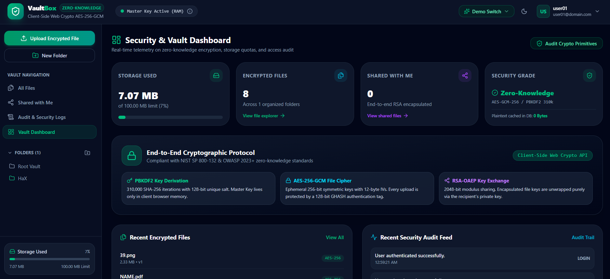 | 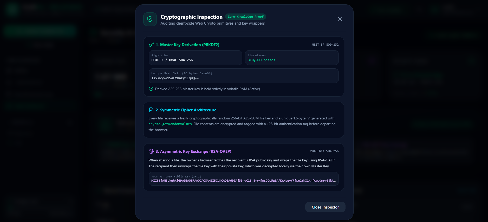 |

---

## Tech Stack

| Layer | Technology |
| :--- | :--- |
| Frontend | React 19, TypeScript, Vite, Tailwind CSS 4, Lucide Icons |
| Backend | Node.js, Express 4, TypeScript (run with `tsx`) |
| Database | MongoDB via Mongoose, with automatic fallback to a persistent local JSON store |
| File storage | Local disk (encrypted blobs only), uploads handled with Multer |
| Auth | JSON Web Tokens, bcryptjs |
| Cryptography | W3C Web Crypto API (`window.crypto.subtle`) |
| DevOps | Docker and Docker Compose |

---

## Architecture and Security Model

```
Password + Salt ──PBKDF2 (310k, SHA-256)──► Master Key (AES-256, non-extractable, RAM only)
                                                │
Plaintext file ──AES-GCM-256 (random key, IV)──►│ wraps file key
        │                                       ▼
        └──► Ciphertext + IV        Wrapped file key (AES-GCM)
                    │                           │
                    └────────── upload ─────────┘
                                │
                         VaultBox server
          (ciphertext on disk, metadata + wrapped keys in DB)

Sharing:  owner unwraps file key ─► re-wraps with recipient's RSA-OAEP public key
          recipient unwraps with their RSA private key (decrypted locally by their Master Key)
```

**Registration**
1. The browser generates a random salt and derives the Master Key from the password.
2. An RSA-OAEP 2048-bit key pair is generated; the private key is encrypted with the Master Key.
3. The server stores the salt, the public key, the encrypted private key, and a bcrypt hash of the password.

**Upload:** generate a file key and IV, encrypt in the browser, wrap the file key with the Master Key, and upload only the ciphertext and wrapped key.

**Download:** fetch the ciphertext and wrapped key, unwrap the file key, decrypt in memory, and verify the 128-bit GCM authentication tag. Any tampering causes decryption to fail.

---

## CRUD Coverage

The application performs full CRUD on its main entities (**Files** and **Folders**), plus **Shares** and **Users**, with all data stored persistently in the database.

| Operation | Files | Folders | Shares / Users |
| :--- | :--- | :--- | :--- |
| **Create** | Encrypted upload; new version on name collision | Create folder with colour tag | Share a file with a user; register an account |
| **Read** | List, search, filter, sort, preview, download, version list | List folder tree and breadcrumbs | Shared-with-me list; per-file access list; audit logs |
| **Update** | Rename, move, restore version | Rename, change colour | Change password (re-wraps private key) |
| **Delete** | Permanently delete file, versions, blobs, and shares | Delete folder (children moved to parent) | Revoke share |

---

## Database Design (ERD)

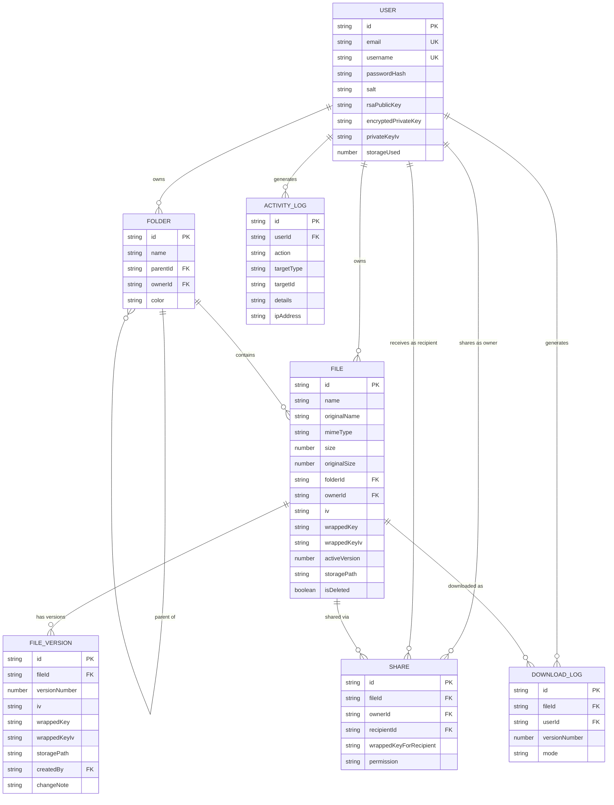

**Key constraints and indexes**
- Unique indexes on `User.email`, `User.username`, and every `id` field.
- Composite unique index on `FileVersion (fileId, versionNumber)`.
- Composite unique index on `Share (fileId, recipientId)`, which prevents duplicate shares.
- Compound indexes on `File (ownerId, folderId, isDeleted)`, `Folder (ownerId, parentId)`, and `ActivityLog (userId, createdAt)` for fast listing and filtering.

---

## Project Structure

```
.
├── server.ts                  # Express entry point (API + Vite middleware / static build)
├── server/
│   ├── config/                # Environment configuration
│   ├── controllers/           # auth, file, folder, share, audit controllers
│   ├── db/                    # Unified data store (MongoDB + local JSON fallback)
│   ├── middleware/            # JWT auth, rate limiter, Multer upload
│   ├── models/                # Mongoose schemas and TypeScript interfaces
│   ├── routes/                # REST route definitions
│   └── services/              # Encrypted blob storage service
├── src/
│   ├── api/                   # Fetch client with auth headers
│   ├── components/            # Modals, file grid/list, sidebar, navbar, toasts
│   ├── context/               # Auth (key management) and Theme providers
│   ├── crypto/webCrypto.ts    # PBKDF2, AES-GCM, RSA-OAEP helpers
│   ├── pages/                 # Login, Register, Vault, Shared, Audit, Dashboard
│   └── types/                 # Shared TypeScript types
├── Dockerfile
├── docker-compose.yml
└── .env.example
```

---

## Getting Started

### Prerequisites

- Node.js **20.19+** (or 22.12+)
- npm
- MongoDB (optional, since the app falls back to a local JSON store if MongoDB is unreachable)

### Installation

```bash
# 1. Clone the repository
git clone https://github.com/<your-username>/<your-repo>.git
cd <your-repo>

# 2. Install dependencies
npm install

# 3. Configure environment variables
cp .env.example .env
# then edit .env (see the table below)

# 4. Start the development server (API + Vite on one port)
npm run dev
```

The app runs at `http://localhost:3000` by default (or the `PORT` you set in `.env`).

### Production build

```bash
npm run build
NODE_ENV=production npm start
```

### Available scripts

| Script | Description |
| :--- | :--- |
| `npm run dev` | Start the Express server with Vite middleware |
| `npm run build` | Build the frontend into `dist/` |
| `npm start` | Start the server (set `NODE_ENV=production` to serve `dist/`) |
| `npm run lint` | Type-check with `tsc --noEmit` |

### Demo accounts

No data is seeded. Register accounts from the **Create new encrypted vault** page. The login page and navbar include one-click shortcuts for these two demo accounts, so register them first if you want to use the shortcuts:

| Username | Email | Password |
| :--- | :--- | :--- |
| User01 | `user01@domain.com` | `user01Pass!` |
| User02 | `user02@domain.com` | `user02Pass!` |

Then use **Demo Switch** in the navbar to move between users and test end-to-end sharing.

---

## Environment Variables

| Variable | Description | Default |
| :--- | :--- | :--- |
| `PORT` | HTTP port | `3000` |
| `JWT_SECRET` | Secret used to sign JWTs. **Change this in production.** | development fallback |
| `JWT_EXPIRES_IN` | Token lifetime | `7d` |
| `MONGODB_URI` | MongoDB connection string. If empty or unreachable, the local store (`data/vaultbox.json`) is used. | empty |
| `UPLOAD_DIR` | Directory for encrypted blobs | `uploads` |
| `NODE_ENV` | Set to `production` to serve the built frontend | – |

---

## Docker Deployment

```bash
docker-compose up --build -d
```

This starts the app on port `3000` together with a MongoDB 6 container. Encrypted uploads, app data, and MongoDB data are stored in named volumes.

> Before deploying anywhere public, replace the `JWT_SECRET` in `docker-compose.yml` with a strong, private value.

---

## REST API Reference

All routes except register and login require `Authorization: Bearer <token>`.

### Auth: `/api/auth`
| Method | Endpoint | Description |
| :--- | :--- | :--- |
| POST | `/register` | Create an account and store the public key material |
| POST | `/login` | Authenticate and receive a JWT plus encrypted key material |
| GET | `/me` | Current user profile and storage usage |
| GET | `/public-key?email=` | Look up a user's RSA public key |
| GET | `/users` | List other users (for the share dialog) |
| POST | `/change-password` | Re-wrap the private key under a new password |

### Files: `/api/files`
| Method | Endpoint | Description |
| :--- | :--- | :--- |
| POST | `/upload` | Upload a ciphertext blob (auto-versioning) |
| GET | `/` | List files (folder and search filters) |
| GET | `/:id` | File metadata |
| GET | `/:id/download` | Stream ciphertext with crypto headers (`?version=`, `?mode=`) |
| PATCH | `/:id/rename` | Rename a file |
| PATCH | `/:id/move` | Move a file to another folder |
| DELETE | `/:id` | Delete a file, its versions, blobs, and shares |
| GET | `/:id/versions` | List versions |
| POST | `/:id/restore-version` | Make a previous version active |

### Folders: `/api/folders`
| Method | Endpoint | Description |
| :--- | :--- | :--- |
| GET | `/` | List folders |
| POST | `/` | Create a folder |
| PATCH | `/:id` | Rename or recolour a folder |
| DELETE | `/:id` | Delete a folder (children moved to parent) |

### Shares: `/api/shares`
| Method | Endpoint | Description |
| :--- | :--- | :--- |
| POST | `/` | Share a file with an RSA-wrapped key |
| GET | `/shared-with-me` | Files shared with the current user |
| GET | `/file/:fileId` | Users with access to a file |
| DELETE | `/:id` | Revoke a share |

### Audit: `/api/audit`
| Method | Endpoint | Description |
| :--- | :--- | :--- |
| GET | `/activity` | Activity log (`action`, `startDate`, `endDate`, `limit`) |
| GET | `/activity/export-csv` | Download the activity log as CSV |
| GET | `/download-history/:fileId` | Download log for one file (owner only) |
| GET | `/dashboard` | Stats, recent files, and recent activity |

### Health
`GET /api/health` returns service status and the active database mode (`MongoDB` or `LocalPersistentStore`).

---

## Validation and Error Handling

- **Client side:** password-strength meter with entropy estimate, password confirmation, required-field checks, and disabled submit buttons while requests are in flight.
- **Server side:** required-field validation on every write endpoint, duplicate email and username checks (`409`), ownership and authorization checks (`403`/`404`), and upload size limit (50 MB).
- **Consistent errors:** every endpoint returns `{ "error": "message" }` with a meaningful HTTP status, a global error handler catches unexpected failures, and the UI surfaces them as toast notifications.
- **Integrity:** AES-GCM authentication tags detect any tampering with stored ciphertext.

---

## Security Notes and Limitations

- The master key is derived in the browser and held in memory as a non-extractable `CryptoKey`. For convenience during a tab session, the password is cached in `sessionStorage`, which is cleared on logout or when the tab closes.
- **A forgotten master password cannot be recovered.** The server cannot decrypt files by design.
- The auth rate limiter is in-memory and per-process; use a shared store for multi-instance deployments.
- The default `JWT_SECRET` fallback is for development only.
- Local-disk blob storage suits a single-node deployment; swap `storageService` for an object store to scale out.

---

## Author

**Denuwan Lakpriya**
Faculty of Engineering, University of Ruhuna
EC4307 – Web Application Development Mini Project