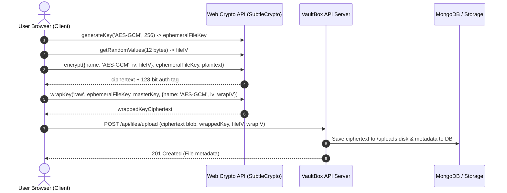

# 🛡️ VaultBox – Secure Cloud File Vault

> **Zero-Knowledge End-to-End Encrypted Cloud Storage** built with React, Vite, Node.js, Express, MongoDB (with persistent fallback), and the **W3C Web Cryptography API**.

---

## 📖 1. Overview & Core Philosophy

Standard cloud file vaults retain plaintext files or raw server-side encryption keys, exposing files to compromised cloud providers, sub-poenas, rogue insiders, and infrastructure leaks.

**VaultBox is strictly Zero-Knowledge**:
1. Files are **encrypted in the browser BEFORE upload** using ephemeral 256-bit AES-GCM keys with a fresh 12-byte IV for every file.
2. The file key is **wrapped in the browser** with the user's Master Key (derived via PBKDF2 with 310,000 iterations).
3. The server **only ever stores ciphertext blobs** and wrapped keys.
4. When downloading, files are **decrypted in the browser in RAM** and authenticated with a 128-bit GHASH tag.
5. Sharing uses **asymmetric RSA-OAEP key wrapping**: the owner unwraps the file key in memory, re-wraps it with the recipient's RSA public key, and posts the wrapped key. The recipient unwraps it with their private key. **The server never observes a raw key or plaintext at any time.**

---

## 🏛️ 2. Architecture & Cryptographic Flow

```
+------------------------------------------------------------------------------------------------+
|                                    CLIENT BROWSER (RAM ONLY)                                   |
|                                                                                                |
|   User Password + Salt (16 bytes)                                                              |
|          │                                                                                     |
|          ▼                                                                                     |
|   PBKDF2 (SHA-256, 310,000 iter) ──► Master Key (AES-256)                                       |
|                                             │                                                  |
|   Plaintext File                            │ (Wrap File Key)                                  |
|          │                                  ▼                                                  |
|          ├──► AES-GCM-256 ──► Ciphertext + Wrapped File Key + 12-byte IV + 128-bit Tag         |
|               (Random Ephemeral Key)        │                                                  |
|                                             │ (Sharing: Re-wrap with Recipient's RSA PubKey)   |
|                                             ▼                                                  |
|                                        RSA-OAEP-2048 Wrapped Key for Recipient                 |
+─────────────────────────────────────────────┬──────────────────────────────────────────────────+
                                              │
                         HTTP POST /api/files/upload (Ciphertext Blob)
                                              │
                                              ▼
+────────────────────────────────────────────────────────────────────────────────────────────────+
|                                     VAULTBOX SERVER & DISK                                     |
|                                                                                                |
|   • Express REST API                                                                           |
|   • Multer Storage Service: writes encrypted blob to /uploads (e.g. enc_17123912.enc)          |
|   • MongoDB / Local DataStore: stores metadata, IV, and wrapped key ciphertexts only           |
|   • ZERO PLAINTEXT SAVED • ZERO RAW KEYS STORED                                                |
+------------------------------------------------------------------------------------------------+
```

### Mermaid Sequence Diagram: File Upload & Encryption



---

## 🔑 3. Key Management & Sharing Architecture

1. **User Registration**:
   - Client generates a random 16-byte salt: `crypto.getRandomValues(new Uint8Array(16))`.
   - Client derives **Master Key** via `PBKDF2` (310,000 iterations, SHA-256).
   - Client generates **RSA-OAEP 2048-bit** key pair.
   - Client encrypts the RSA private key using the Master Key (`AES-GCM`).
   - Server stores `salt`, `rsaPublicKey`, `encryptedPrivateKey`, and bcrypt-hashed login password.

2. **File Sharing**:
   - Owner unwraps the file's AES key using their Master Key.
   - Owner queries recipient's public key from `/api/auth/public-key?email=recipient@vaultbox.io`.
   - Owner encrypts/wraps the AES file key with recipient's RSA-OAEP public key.
   - Server records share with `wrappedKeyForRecipient`.
   - Recipient logs in, derives their Master Key, decrypts their RSA private key into browser memory, and unwraps the shared file key.

3. **Tamper Proofing & Authentication Tag**:
   - AES-GCM outputs a 128-bit authentication tag with the ciphertext.
   - If any bit of the ciphertext or IV is altered, `window.crypto.subtle.decrypt()` rejects with an integrity violation before any bytes are decoded.

---

## 🚀 4. Quickstart & Installation

```bash
# 1. Install dependencies
npm install

# 2. Start full-stack server (Node.js + Express + Vite on port 3000)
npm run dev
```

The application will run on `http://localhost:3000`.

### Pre-Seeded Demo Accounts for Instant Testing

The database automatically seeds two demo user accounts:

| User | Email | Password | Role |
| :--- | :--- | :--- | :--- |
| **Alice** | `alice@vaultbox.io` | `Password123!#` | Vault Owner (Contains pre-encrypted files & folders) |
| **Bob** | `bob@vaultbox.io` | `Password123!#` | Recipient (Has pre-shared files from Alice) |

> *Tip: Use the **"Demo Switch"** button in the top navigation bar to instantaneously toggle between Alice and Bob to test end-to-end sharing!*

---

## 📡 5. REST API Endpoints Summary

### Authentication (`/api/auth`)
- `POST /api/auth/register` - Register user, receive JWT, initialize cryptographic parameters.
- `POST /api/auth/login` - Authenticate with password hash and retrieve encrypted keys + salt.
- `GET  /api/auth/me` - Get authenticated user profile and storage stats.
- `GET  /api/auth/public-key?email=:email` - Retrieve target user's RSA-OAEP public key.
- `GET  /api/auth/users` - List registered users for autocomplete in the share modal.
- `POST /api/auth/change-password` - Re-wrap keys under a new master password.

### Files (`/api/files`)
- `POST   /api/files/upload` - Upload encrypted blob + wrapped key metadata. Handles auto-versioning!
- `GET    /api/files` - List user files with folder & search filters.
- `GET    /api/files/:id` - Fetch file metadata.
- `GET    /api/files/:id/download` - Stream ciphertext blob with cryptographic headers (`X-Vault-IV`, `X-Vault-Wrapped-Key`).
- `PATCH  /api/files/:id/rename` - Rename file metadata.
- `PATCH  /api/files/:id/move` - Move file to a different folder.
- `DELETE /api/files/:id` - Permanently remove ciphertext blobs, versions, and shares.
- `GET    /api/files/:id/versions` - List historical immutable snapshots.
- `POST   /api/files/:id/restore-version` - Restore historical version snapshot as active.

### Folders (`/api/folders`)
- `GET    /api/folders` - List folder tree hierarchy.
- `POST   /api/folders` - Create new folder with custom color tag.
- `PATCH  /api/folders/:id` - Rename folder.
- `DELETE /api/folders/:id` - Delete folder and preserve items in parent.

### Sharing (`/api/shares`)
- `POST   /api/shares` - Create share record with RSA-wrapped file key.
- `GET    /api/shares/shared-with-me` - List files shared with current user.
- `GET    /api/shares/file/:fileId` - List users with access to file.
- `DELETE /api/shares/:id` - Revoke shared access.

### Audit & Logs (`/api/audit`)
- `GET /api/audit/activity` - Query global security log with action and date filters.
- `GET /api/audit/activity/export-csv` - Export audit events to downloadable CSV.
- `GET /api/audit/download-history/:fileId` - Query download logs for a specific file.
- `GET /api/audit/dashboard` - Retrieve telemetry, storage quotas, and recent logs.

---

## 🐳 6. Docker & DevOps

```bash
# Build and run application + MongoDB container:
docker-compose up --build -d
```

---

## 🎓 7. Viva & Technical Defense Q&A

1. **Why not encrypt files on the server using Node's crypto library?**
   - If encryption occurs on the server, the server holds both the plaintext and the encryption key. A compromise of the server or a rogue administrator would expose all files. VaultBox performs encryption exclusively in the client's browser using Web Crypto API before transmission.
2. **How does PBKDF2 protect against brute-force attacks?**
   - PBKDF2 applies 310,000 iterations of SHA-256 HMAC along with a 128-bit salt. This computational cost prevents rainbow table attacks and slows dictionary attacks to a crawl.
3. **Why use AES-GCM rather than AES-CBC?**
   - AES-GCM provides authenticated encryption (AEAD). Along with encryption, it calculates a 128-bit GHASH authentication tag. Any tampering, truncation, or bit-flipping during transit or storage results in an authentication error before decryption occurs.
4. **How does file sharing work without sharing the user's master password?**
   - Each file has an independent, randomly generated 256-bit AES key. Sharing involves unwrapping only that file's key and re-encrypting it with the recipient's RSA-OAEP public key. The owner's master password and master key are never exposed.
